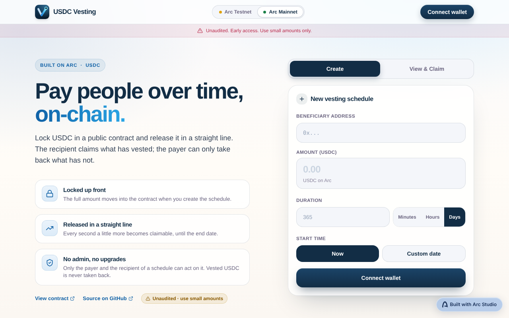

# USDC Vesting




A USDC linear-vesting and scheduled payout app on Arc (Testnet and Mainnet). A sender creates a vesting schedule for a beneficiary by depositing USDC with a start time and duration. The beneficiary claims vested USDC linearly over time. The sender can cancel and reclaim only the unvested portion; the beneficiary can still claim any vested-but-unclaimed USDC after cancellation.

Built with [Arc Studio](https://studio.arc.io)

## Tech Stack

- Frontend: React 18, Vite, TypeScript, Tailwind CSS, Framer Motion
- Web3: wagmi v2, viem, ConnectKit
- Contracts: Solidity 0.8.28, OpenZeppelin SafeERC20 + ReentrancyGuard, Foundry
- Chains: Arc Mainnet (Chain ID: 5042) and Arc Testnet (Chain ID: 5042002)
- Token: USDC (ERC-20, 6 decimals, `0x3600000000000000000000000000000000000000`)

## Live App

https://arc-usdc-vesting.vercel.app

## Deployed Contracts

| Contract     | Chain        | Address                                      |
|--------------|--------------|----------------------------------------------|
| VestingVault | Arc Testnet  | `0x75bb671393cb84e97c62f4d203124c7e34519a15` |
| VestingVault | Arc Mainnet  | `0x5F794fEc98BD7580Cb30CE36697562ca6CbcB4f3` |

Constructor argument (USDC token, both networks): `0x3600000000000000000000000000000000000000`

Testnet deploy tx: `0x09cf0849c0c137ab8ae2c4850b29ad42791f4a02d2b9e074b65583bd1a43a774`
Mainnet deploy tx: `0x6df6bb54571f992331b00a6ba36fc3ad5336eae4482c76606e5cd1116e68b7c9` (block 27882141, Oct 26 2026)

Mainnet deployment note: Arc Studio deploys to Testnet only, so the Mainnet contract was deployed manually via Remix using the deployment pack generated by Arc Studio (solc 0.8.28, optimizer 200 runs, EVM cancun, OpenZeppelin 5.6.1).

Explorer source verification: both contracts are verified on Arc Explorer (exact match, solc 0.8.28+commit.7893614a, optimizer 200 runs, EVM cancun).
- Mainnet: https://explorer.arc.io/address/0x5F794fEc98BD7580Cb30CE36697562ca6CbcB4f3?tab=contract
- Testnet: https://explorer.testnet.arc.io/address/0x75bb671393cb84e97c62f4d203124c7e34519a15?tab=contract
 The exact compiler input is also in this repo: `deploy/VestingVault.flat.sol` and `deploy/standard-json-input.json`.

Status: UNAUDITED. Use small amounts only.

## Verified on Arc Mainnet

The full flow was exercised by hand on Arc Mainnet with small amounts (0.2 and 0.5 USDC) using three wallets:

| Flow | Result |
|---|---|
| Approve the exact amount, then `createSchedule` | Schedule created; vested amount matched the linear formula to the second |
| `claim` by the beneficiary, mid-schedule and after the end | Paid exactly the vested amount; two claims summed to the full 0.5 USDC |
| `cancel` by the sender, mid-schedule | Unvested part (0.190889 of 0.2 USDC) returned to the sender, the rest frozen for the beneficiary |
| `claimAfterCancel` by the beneficiary | The frozen 0.009111 USDC was paid out, and the schedule was settled |
| `createSchedule` for a pair whose previous schedule was not settled | Reverted on-chain; the UI reports the failure instead of a false success |

In every case the amounts add up exactly: nothing is created or lost by the contract. Gas on Arc is paid in USDC and was about 0.0006 to 0.002 USDC per transaction.

## Design notes and limits

- **One schedule per sender and beneficiary pair** until the previous one is fully settled (`PriorVestingNotSettled`).
- **The sender can cancel.** Only the unvested part comes back; the vested part always stays claimable by the beneficiary.
- **No owner, no admin, no upgrade.** Nobody, including the deployer, can move funds out of a schedule.
- **No yield.** The contract only holds and releases USDC. Locked funds do not earn interest.
- **Unaudited.** Use small amounts only.
- The app opens on Arc Testnet by default. Use `/?network=mainnet` to open it on Mainnet.

## Development

### Prerequisites

- [Bun](https://bun.sh) >= 1.0
- [Foundry](https://getfoundry.sh) (for contract work)

### Install

```bash
bun install
```

### Environment Variables

None required. RPC access is provided via Arc Studio's proxy when running inside Arc Studio. Outside Arc Studio, public Arc Testnet RPC (`https://rpc.testnet.arc.io`) is used automatically.

| Variable | Purpose |
|---|---|
| `RPC_PROXY_BASE_URL` | Optional — Arc Studio RPC proxy base URL |
| `RPC_PROXY_TOKEN` | Optional — Arc Studio RPC proxy token |
| `RPC_PROXY_CHAINS` | Optional — comma-separated list of chains supported by the proxy |

### Run

```bash
bun run dev
```

### Build

```bash
bun run contracts:build   # compile contracts
bun run contracts:test    # run Foundry tests
```

## App Features

- **Create schedule**: Approve the exact USDC amount, set beneficiary address, amount, duration (minutes, hours or days), and start time (now or a future date). A live release preview shows the rate (USDC per unit) and the date the schedule is fully vested. Passes `startTime = 0` to the contract when "Now" is selected, which resolves to `block.timestamp` on-chain.
- **View & Claim**: Look up any vesting schedule by sender + beneficiary address. Shows vested and claimable amounts live. Beneficiaries can claim vested USDC; senders can cancel and reclaim the unvested portion.
- **Cancelled schedules**: After a sender cancels, the app detects the cancelled state (`vestedAmount = 0` but `claimable > 0`) and automatically routes the beneficiary's claim to `claimAfterCancel`.
